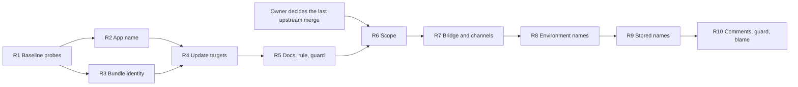

# Plan for the pi to Theta rename

Status: plan only. Nothing in this plan changes code until the owner says go.

Baseline: `main` at `96409f0c` on 2026-11-22. Every count below was measured at that
commit, and each count lists the command that regenerates it.

## What changes

Today the window title and the app menu read `pi`. Dialogs, the macOS bundle, and the
installers read `pi-gui`. After this plan each of them reads **Theta**. Settings move to a
new data folder, and the owner's current settings are copied there before the first launch.

The work has two stages.

- Stage A renames what a user can see, the data folder, and the update source. It lands
  now. A later merge from upstream `pi-gui` conflicts only on the lines that Stage A
  changed.
- Stage B renames the package scope, code identifiers, IPC strings, and environment names.
  It lands after the last upstream merge. After Stage B, each upstream merge conflicts on
  every renamed line.

Names that mean the `pi` agent itself never change.

## Names to confirm before go

The values in the second column are proposals. Change them before R2 starts. Each later
unit uses the values that you confirm.

| What                        | Today                            | Proposed                                | Locked when                      |
| --------------------------- | -------------------------------- | --------------------------------------- | -------------------------------- |
| Display name                | `pi-gui` in dialogs, `pi` in menu | `Theta`                                 | First build that you share       |
| Bundle ID                   | `com.pi-gui.desktop`             | `io.github.hugolld.theta-desktop`       | First build that you share       |
| Data folder                 | `<appData>/pi`                   | `<appData>/Theta`                       | First build that you share       |
| Linux executable, deb name  | `pi-gui`                         | `theta-desktop`                         | First Linux build that you share |
| macOS notification helper   | `pi-gui-notification-status-helper` | `theta-notification-status-helper`    | Same                             |
| Update source               | `minghinmatthewlam/pi-gui`       | `hugolld/theta-desktop`                 | First published release          |
| Workspace scope             | `@pi-gui/*`, `@pi-app/video`     | `@theta-desktop/*`                      | Never. All packages are private. |
| Root package name           | `pi-gui`                         | `theta-desktop`                         | Never                            |
| Bridge global and types     | `piApp`, `PiDesktop*`            | `thetaApp`, `ThetaDesktop*`             | Never                            |
| Environment prefix          | `PI_APP_*`, `PI_GUI_*`           | `THETA_APP_*`, `THETA_GUI_*`            | First documented release         |
| Verification skill          | `verify-pi-gui`                  | `verify-theta-desktop`                  | R5                               |

Three installer fields also need your values, because R3 writes them into
`apps/desktop/electron-builder.yml`:

- `copyright`. Proposed: `Copyright 2026 Theta contributors. Portions Copyright 2026 Matthew Lam, MIT license.`
  The MIT license requires that upstream's notice stays with its code.
- Linux `maintainer`. Proposed: your name and email. Today the field holds the upstream
  author's address, and Linux users send package problems to that address.
- `vendor`. Proposed: `Theta`.

The bundle ID is permanent after the first shared build. macOS ties notification access,
the app defaults, and the update identity to it. If the campaign owns a domain, use that
domain in the reverse form instead of `io.github`.

## Names that stay pi

Never rename these. A rename breaks the `pi` integration or orphans stored values.

- The `pi` agent and its paths: `pi`, `@earendil-works/pi-coding-agent`, `~/.pi/agent`,
  `.pi/settings.json`, `PI_CODING_AGENT_DIR`, and `pi install npm:theta-agent`.
- `pi-sdk-driver`. The package adapts the `pi` SDK.
- Identifiers that the app writes outside its code. I read each one in the source:

  - The checkpoint git refs `refs/pi-gui/snapshots/` in each user repository
    (`apps/desktop/electron/workbench/checkpoint-store.ts:63`).
  - The built-in extension names that `ui-state.json` stores for extensions that the user
    switched off (`apps/desktop/electron/application/app-store.ts:2251`). The names are
    `pi-gui-thread-orchestration`, `pi-gui-scheduled-tasks`, `pi-gui-desktop-views`,
    `pi-gui-plan-limits`, `pi-gui-transcript-identity`, and `pi-gui-turn-capture`.
  - The transcript entry types `pi-gui.card` and `pi-gui.pin`
    (`packages/session-driver/src/transcript.ts:61`), and the prompt block markers
    `<pi-gui-file-attachments>` (`packages/pi-sdk-driver/src/session-supervisor-utils.ts:35`).
  - The session lease value `PI_GUI_LEASE_SURFACE = "pi-gui"`
    (`packages/pi-sdk-driver/src/session-lease.ts:36`).

- Attribution for upstream: `LICENSE`, `NOTICE.md`, and the fork note at the top of
  `README.md`.

On 2026-11-22, 0 of 56 session files in `~/.pi/agent/sessions` contained any of the
stored identifiers above. Command: `rg -l -F '<identifier>' ~/.pi/agent/sessions | wc -l`.

## Landing order and dependencies

R1 to R10 are the review units. Each unit is one commit series on the current branch
`main`, because the repo rule forbids new branches unless you ask. If you prefer pull
requests, each unit becomes one pull request.

- R2 and R3 do not depend on each other. Each one is green when it lands alone.
- R1 comes first. The perf boxes of the later units compare against its trunk numbers.
- R5 comes last in Stage A. Its documents describe the result of R2 to R4.
- R6 to R10 are sequential. R6 also waits for your upstream decision.

Do not start a unit before the current one is green. Evidence for each unit goes to
`.artifacts/rename/<R>/`.

## Stage A. Land now

### R1 Baseline probes

Status: green on 2026-11-22.

- [x] Depends on nothing.
- [x] Add `apps/desktop/tests/perf/startup-profile.spec.ts` and the script
      `test:perf:startup` in `apps/desktop/package.json`.
- [x] Add `apps/desktop/tests/production/profile-snapshot.spec.ts`, the preflight script
      `apps/desktop/scripts/require-profile-source.mjs`, and the script
      `test:prod:profile-snapshot`.
- [x] Run both probes on trunk. The results are in `.artifacts/rename/R1/`.

The startup probe launches the built app ten times through the standard helper
`launchDesktop()`. The first launch is a warm-up. Nine launches are measured. It records
two numbers:

- `startupMs`. The time from the `launchDesktop()` call to the resolved `firstWindow()`.
- `pingMs`. The mean time of 200 sequential `window.piApp.ping()` calls. The renderer clock
  moves in steps of 0.1 ms, so one call is too short to time on its own.

The profile snapshot copies the data folder that `PI_APP_PROFILE_SOURCE_DIR` names. It
launches the app on the copy without test mode. It writes these to one JSON file:
`getState()` without `revision`, all `localStorage` entries, the window title,
`app.getName()`, `app.getPath("userData")`, and the `*.json` files in the folder root after
the app quits. Paths under the temporary folder become `<tmp>`.

The JSON has two objects. `identity` holds the app name, the title, and the data path.
`profile` holds everything else. Only `profile` is compared, because R2 changes `identity`
by design.

| File in `.artifacts/rename/R1/`                    | Content                                                                                                 |
| -------------------------------------------------- | ------------------------------------------------------------------------------------------------------- |
| `startup-trunk.json`, `startup-trunk-2.json`       | Two trunk startup runs                                                                                  |
| `profile-trunk.json`, `profile-trunk-2.json`       | Two trunk snapshots of two copies of the owner's data folder                                            |
| `profile-source-nondefault/`                       | A copy of the owner's data folder with three settings away from their defaults                          |
| `profile-trunk-nondefault.json`                    | A trunk snapshot of that copy                                                                           |

The changed copy sets theme mode `dark`, thread grouping `workspace`, and background
completion notices off. The owner's data folder holds no workspace and no thread, and each
stored setting has its default value. A default-valued folder cannot show the difference
between a setting that was found and a setting that was lost. The changed copy closes that
gap, and the owner's folder stays untouched.

Verification:

- [x] Unit. `pnpm check` passed. Desktop unit tests: 424 passed, 1 skipped. The log is
      `.artifacts/rename/R1/check.log`.
- [x] Live. Both probes ran on the real Electron window. Three trunk startup runs had
      medians of 827.9 ms, 846.5 ms, and 835.3 ms. The largest difference is 2.2%. The
      `profile` objects of the two copies are equal. The changed copy restored `dark`,
      `workspace`, and `backgroundCompletion: false` into the state and into `ui-state.json`.
- [x] Perf. Trunk numbers from `startup-trunk.json`: `startupMs` median 827.9 ms, min
      799.8 ms, max 846.9 ms. `pingMs` mean 0.047 ms.

Fail numbers for every later unit. Set `STARTUP_BASELINE=.artifacts/rename/R1/startup-trunk.json`,
and the probe enforces them:

- `startupMs`. Fail when the 9-run minimum is above the trunk minimum × 1.15. That is
  919.8 ms.
- `pingMs`. Fail when the median of the per-run means is above the trunk value × 2. That is
  0.094 ms.

Two changes from the first draft of this plan, each with its reason:

- The minimum decides, not the median. One trunk run had a median of 1136.9 ms while the
  machine was busy. Other processes slow a launch and never speed one up, so the minimum is
  the number that noise cannot raise.
- The ping margin is relative. A trunk ping takes 0.047 ms, so the old absolute margin of
  0.25 ms was five times the signal.

A run against an impossible baseline failed on both numbers, so the check can fail.

### R2 App name in the running app

Status: green, 2026-11-22. Implemented and verified on the real Electron app. Awaiting the
owner's review of the visible result before the commit. Evidence lives under
`.artifacts/rename/R2/` (gitignored) and `.artifacts/verify-pi-gui/run-msfHQq/`.

- [x] Depends on R1 for the baseline files.
- [x] Edit these files (actual lines after the edits; the plan's first table missed six
      files that triage found, and the five specs that assert the changed strings):

      | File                                                            | Lines                |
      | --------------------------------------------------------------- | -------------------- |
      | `apps/desktop/index.html`                                       | 6, the title         |
      | `apps/desktop/electron/main.ts`                                 | 363, 368 strings; 377, 789, 805, 814, 823, 1517 titles; 935 `app.setName` |
      | `apps/desktop/electron/ipc/request-validation.ts`               | 546                  |
      | `apps/desktop/electron/application/app-store.ts`                | 1847, 3205, 3239     |
      | `apps/desktop/electron/platform/worktrees/worktree-manager.ts`  | 201                  |
      | `apps/desktop/src/app/desktop-recovery.tsx`                     | 33, 84, 105          |
      | `apps/desktop/src/app/App.tsx`                                  | 1161                 |
      | `apps/desktop/src/i18n/messages/en.ts`                          | 9 strings            |
      | `apps/desktop/src/i18n/messages/zh-CN.ts`                       | 9 strings            |
      | `apps/desktop/src/features/extensions/extension-display.ts`     | 10, the tools label  |
      | `apps/desktop/src/features/scheduled-tasks/scheduled-tasks-view.tsx` | 134            |
      | `apps/desktop/src/features/threads/hooks/use-workspace-menu.tsx` | 145                 |
      | `packages/pi-sdk-driver/src/unsupported-host-ui.ts`             | 38, 45               |
      | `packages/pi-sdk-driver/src/custom-provider-store.ts`           | 56                   |
      | `packages/pi-sdk-driver/src/session-supervisor.ts`              | 2398                 |
      | `apps/desktop/tests/core/app-identity.spec.ts`                  | New file             |
      | `apps/desktop/tests/unit/renderer-error-boundary.spec.ts`       | 33                   |
      | `apps/desktop/tests/unit/worktree-manager.spec.ts`              | 292, 313             |
      | `apps/desktop/tests/core/extension-command-compatibility.spec.ts` | 93, 115, 181       |
      | `apps/desktop/tests/core/extensions.spec.ts`                    | 650, 672, 730        |
      | `packages/pi-sdk-driver/test/custom-provider-store.test.mts`    | 86                   |

- [x] Build one change. The running app says **Theta**, and it opens `<appData>/Theta`.
      `app.setName("pi")` becomes `app.setName("Theta")` at `main.ts:935`.
- [x] Triage each remaining hit of
      `rg -P -n '(?<!@)\bpi-gui\b' apps/desktop/src apps/desktop/electron packages -g '!*.spec.ts' -g '!*.test.mts' -g '!dist' -g '!node_modules'`.
      Fixed every string that a user can see. Classification of the rest, one bucket per
      later unit: model-facing tool descriptions in `orchestration-runtime.ts`,
      `scheduled-task-runtime.ts`, and the builtin extension descriptions in `main.ts` go
      to R10. Log prefixes `[pi-gui]` in `app-store.ts`, `runtime-supervisor.ts`, and
      `npm-package-fallback.ts`, the internal error in `window-owner.ts:180`, the
      `pi-gui-review-` temp prefix, and package `description` fields go to R10. Stored
      names go to R9 or R7; see the note below. Update URLs in `update-checker.ts` go to
      R4. The `verify-pi-gui` mock fixtures go to R5.
- [x] The app shows **Theta** in the window title, in the app menu, and in the Settings
      text about language, appearance, and notifications.

The dev launch runs the Electron binary. Only a packaged bundle proves the Dock name, so
the Dock check is in R3.

Data folder. R2 comes with operator steps and no migration code. theta-desktop has one
owner with old settings. A copy keeps the old folder for upstream `pi-gui`, so both apps
can run on one Mac. Migration code would stay in `main.ts` for one launch.

1. Quit every running copy of the app.
2. Confirm that the old folder has no `worktrees`, `attachments`, or `turn-checkpoints`
   folder. Git stores absolute paths for app worktrees, so a moved worktree breaks. If one
   of these folders exists, stop and decide how to move it. Command:
   `ls "$HOME/Library/Application Support/pi"`.
3. Confirm that the new folder does not exist.
4. Copy the folder:
   `cp -R "$HOME/Library/Application Support/pi" "$HOME/Library/Application Support/Theta"`.
5. Confirm that `diff -rq` of the two folders prints nothing.
6. Create a marker file with `touch /tmp/theta-rename-marker`. Launch and quit the app one
   time. Then `find "$HOME/Library/Application Support/pi" -newer /tmp/theta-rename-marker -type f`
   prints nothing, and `find "$HOME/Library/Application Support/Theta" -newer /tmp/theta-rename-marker -type f`
   prints at least one file.

The old folder stays. Its deletion needs your approval. On Linux the folder is
`~/.config/pi`. On Windows it is `%APPDATA%\pi`.

The operator steps ran as written. The copy was byte-identical (`diff -rq` silent). The
normal launch, with no test environment, opened
`/Users/hugodong/Library/Application Support/Theta` and restored the owner's stored
values. The old folder had 0 files newer than the marker; the new one had 16.

Verification:

- [x] Unit. `pnpm check` passes (`check.log`). Desktop unit 424 passed, 1 skipped.
      pi-sdk-driver 206 passed, 0 failed.
- [x] Live 1. `apps/desktop/tests/core/app-identity.spec.ts` plus the changed specs:
      core lane 13 of 13 passed on the real Electron window (`core.log`). The new spec
      asserts the title, `app.getName()`, and, on macOS, the app-menu label that
      `main.ts:838` builds from `app.name`.
- [x] Live 2. The profile snapshot ran on both copies (`profile-r2.json`,
      `profile-r2-nondefault.json`, logs `profile-a.log`, `profile-b.log`). `profile`
      equals `profile-trunk.json` for both. `identity` now reads appName `Theta`,
      userData `.../Application Support/Theta`, document title `Theta`. The non-default
      copy restored `dark`, `workspace` grouping, and background completion off.
- [x] Live 3. Operator steps 1 to 6 pass (`normal-launch.json`, `normal-launch.png`).
      Restored settings equal the owner's stored values; localStorage holds
      `pi-gui.last-theme: default:dark` (the stored-key rename is R9, not R2).
- [x] Live 4. `prove.sh --smoke` passed (`smoke.log`), one test, no assertion failures,
      normal visible launch with the owner's real auth. Evidence
      `.artifacts/verify-pi-gui/run-msfHQq/`: the Settings screenshots show "The Theta
      palette.", the language and notification strings with Theta.
- [x] Perf. Startup probe against the R1 trunk baseline (`startup-r2.json`):
      startupMs median 828.7 ms (trunk 827.9), min 809.5 ms (limit 919.8), max 908.2.
      readyMs median 957.7 ms (trunk 975.3). pingMs 0.050 ms (trunk 0.047, limit 0.094).
      The baseline check passed.
- [ ] Review. You see the new title, the app menu, and the Settings text before this
      unit's commit is pushed. The evidence above stands in for a live viewing; a launch
      of the built app shows all three.

Note for R9. The stored names are six localStorage keys, not four:
`pi-gui:locale`, `pi-gui.last-theme`, `pi-gui.review-tree-visible`
(`src/features/workbench/diff-panel.tsx:756`), `pi-gui:thread-switcher-order:v1`,
`pi-gui.workbench-width` (`src/features/workbench/use-workbench-width.ts:6`, asserted in
`tests/core/workbench-tabs.spec.ts:558`), and `pi-gui.sidebar-width`
(`src/features/threads/sidebar.tsx:170`). R9 also owns the generated names: git refs
`refs/pi-gui/snapshots/`, custom transcript types `pi-gui.card` and `pi-gui.pin`,
`<pi-gui-file-attachments>` blocks, extension ids such as `pi-gui-thread-orchestration`,
`PI_GUI_LEASE_SURFACE`, and the notification helper name.

### R3 Bundle and installer identity

Status: green, 2026-11-22. Implemented and verified on this Mac. The owner confirmed the
installer values: copyright adds Theta, Linux maintainer is the owner's git identity,
vendor is `theta`. The first table missed the `refresh-macos-update-metadata.mjs` dmg
base and the homebrew artifact references; both are in this unit.

Confirmed values: appId `io.github.hugolld.theta-desktop`, productName `Theta`,
copyright `Copyright 2026 Matthew Lam and Theta contributors`, Linux executable and deb
package `theta-desktop`, maintainer `hugolld <hugo.lilong.dong@outlook.com>`, vendor
`theta`, Windows executable `theta-desktop`, helper
`theta-notification-status-helper`. The deb installs to `/opt/Theta` (the sanitized
product name) with the executable `theta-desktop` inside; the desktop entry, icons, and
apparmor profile follow the executable name.

- [x] Depends on no code. Land it after R2, so that the first packaged app is complete.
- [x] Edit these files:

      | File                                                  | Change                                             |
      | ----------------------------------------------------- | -------------------------------------------------- |
      | `apps/desktop/electron-builder.yml`                   | `appId`, `productName`, `copyright`, `linux.executableName`, `linux.maintainer`, `linux.vendor`, `deb.packageName`, `win.executableName`, both helper paths |
      | `apps/desktop/package.json`                           | `homepage`                                         |
      | `apps/desktop/scripts/build-notification-status-helper.mjs` | Output name                                  |
      | `apps/desktop/electron/platform/notification-permission.ts` | Helper name. Must match the binary           |
      | `apps/desktop/scripts/verify-release-config.mjs`      | Homepage, executable name, maintainer, deb package assertions; the Linux verifier marker |
      | `apps/desktop/scripts/assert-packaged-runtime-deps.mjs` | Bundle paths and helper name                    |
      | `apps/desktop/scripts/release-artifacts.mjs`          | `PRODUCT_NAME = "Theta"`                           |
      | `apps/desktop/scripts/release-artifacts.test.mjs`     | Artifact name assertions                           |
      | `apps/desktop/scripts/refresh-macos-update-metadata.mjs` | DMG/zip base name                               |
      | `apps/desktop/scripts/finalize-macos-release.sh`      | Artifact and bundle paths                          |
      | `apps/desktop/scripts/verify-linux-release.sh`        | 57 references: artifacts, `/opt/Theta`, executable, control fields |
      | `apps/desktop/scripts/verify-windows-release.ps1`     | Executable and artifact names                      |
      | `.github/workflows/release.yml`                       | `win-unpacked` executable and DMG asset names      |
      | `apps/desktop/tests/helpers/packaged-app.ts`          | Bundle name lookups                                |
      | `apps/desktop/tests/production/release-zip-reopen-new-thread.spec.ts` | Bundle names |
      | `apps/desktop/tests/production/finder-env-open-folder.spec.ts` | Bundle name                |
      | `apps/desktop/tests/production/applications-relaunch.spec.ts` | Bundle name                 |
      | `scripts/homebrew-tap-utils.mjs`                      | `app "Theta.app"`                                  |
      | `scripts/verify-homebrew-flow.mjs`                    | DMG and bundle paths                               |

      Untouched on purpose: cask token defaults, the cask `name`/`homepage`, the
      `minghinmatthewlam/homebrew-tap` checkout, and the `publish` block. They move in
      R4 with the release target. Temp-dir prefixes stay for R10. `@pi-gui/*` scope
      names stay for R6.

- [x] Build one change. The bundle, the helper binary, the executables, and the installers
      carry Theta names and the new bundle ID.
- [x] `apps/desktop/release/mac-arm64/Theta.app` and `Theta-1.0.1-arm64.dmg` exist.

Verification:

- [x] Unit. `pnpm verify:release-config` prints "Release package and workflow
      configuration are valid." `pnpm test:release-helpers` passes 27 of 27.
      `pnpm test:homebrew-tap` passes. `pnpm check` passes (desktop unit 424 passed,
      1 skipped).
- [x] Live 1. `pnpm --filter @pi-gui/desktop run package:dir` succeeds. PlistBuddy prints
      `CFBundleName Theta` and `CFBundleIdentifier io.github.hugolld.theta-desktop`;
      `Contents/MacOS` holds `Theta` and `theta-notification-status-helper`.
      `CFBundleName` is what the Dock shows, so the packaged Dock name is Theta.
- [x] Live 2. `test:prod:packaged-smoke` passes on the packaged Theta bundle (1 test).
      `verify:packaged-runtime-deps` also passes against the Theta app.asar.
- [x] Live 3. `pnpm --filter @pi-gui/desktop run package` builds
      `release/Theta-1.0.1-arm64.dmg` and `.zip` with blockmaps. Notarization is skipped
      locally (no App Store Connect credentials); the release workflow runs it on CI.
- [ ] Perf. Not applicable. This unit changes no file that the running app loads.
- [ ] After the push that you approve, the `desktop-package-linux` and
      `desktop-package-windows` jobs pass on the fork. Linux lands as
      `/opt/Theta/theta-desktop` with the deb package `theta-desktop`.

If the full Xcode selection blocks `swiftc` on this host, set
`DEVELOPER_DIR=/Library/Developer/CommandLineTools` for the helper build. Confirm with
`xcrun --find swiftc` first. Not needed: `swiftc` already resolves there.

### R4 Update and release targets

Status: green, 2026-11-22. Implemented and verified. The owner approved the local stub
proof: this Mac sits behind a shared proxy exit that drains GitHub's unauthenticated
60-per-hour API pool within seconds of every reset, so the plan's network step cannot run
from here. The endpoint answers were captured with an authenticated `gh` call, and the
app ran against those exact bodies.

- [x] Depends on R3. Both units edit `electron-builder.yml` and `release.yml`.
- [x] Edit these files:

      | File                                               | Change                                      |
      | -------------------------------------------------- | ------------------------------------------- |
      | `apps/desktop/electron/platform/update-checker.ts` | Both URLs now the fork; notification title; the 404 message. `RELEASES_URL` and `RELEASES_PAGE` are exported for the unit spec |
      | `apps/desktop/tests/unit/update-checker.spec.ts`   | New test asserts the fork URLs; `releaseUrlFor` expectations moved |
      | `apps/desktop/electron-builder.yml`                | `publish.owner: hugolld`, `publish.repo: theta-desktop` |
      | `scripts/homebrew-tap-utils.mjs`                   | Cask token `theta-desktop`; cask `name "Theta"`; fork homepage |
      | `scripts/release-homebrew-sync.mjs`                | Cask token default                          |
      | `scripts/update-homebrew-tap.mjs`                  | Cask token default                          |
      | `scripts/verify-homebrew-flow.mjs`                 | Proof cask token default                    |
      | `scripts/test-update-homebrew-tap.mjs`             | DMG fixture names                           |
      | `.github/workflows/release.yml`                    | DMG pattern moved to `Theta-...` in R3; nothing left here |

      The `sync-homebrew` job keeps the upstream tap checkout per the note below; only
      the token default changed.

- [x] Build one change. The app asks `hugolld/theta-desktop` for updates, and the update
      dialogs say Theta.
- [x] The update check targets the fork. Data layer: `gh api
      repos/hugolld/theta-desktop/releases/latest` returns 404 and upstream returns
      `v1.0.1`, the exact contrast the dialogs show.

Verification:

- [x] Unit. `update-checker.spec.ts` (7 tests) asserts that the checker's URL constants
      are `https://api.github.com/repos/hugolld/theta-desktop/releases/latest` and the
      matching releases page. `pnpm test:homebrew-tap` passes. `pnpm check` passes.
- [x] Live, stub-backed (`.artifacts/rename/R4/update-check-stub.mjs`, result in
      `update-check-stub.json`). The main process's `net.fetch` was patched to assert
      the requested URL and play back the captured endpoint bodies. Four checks pass:
      every request hit the fork URL with `Accept: application/vnd.github.v3+json`; the
      fork 404 produced "Could not check for updates right now." with detail "No Theta
      release has been published yet."; upstream's v1.0.1 body produced "You're up to
      date on version 1.0.1." — the old-target contrast. A real-network run earlier the
      same day proved the full path reaches GitHub's API (the recorded dialog showed the
      rate-limit response, `GitHub Releases returned 403.`). After a push that you
      approve, the fork's CI or any unproxied network reproduces the 404 dialog against
      the real endpoint.
- [x] Perf. Not applicable. This unit changes no startup path.

The `sync-homebrew` job keeps the upstream tap repository until M8 creates a Theta tap.
The job cannot publish from the fork, because it needs the `HOMEBREW_TAP_TOKEN` secret.

### R5 Documents, names rule, guard, skill

Status: green, landed 2026-11-22 as `5dfffe7d`. The owner approved the commit after
the README and names rule were presented. Note: `git mv` had staged the skill
folder rename before the R4 commit, so the pure rename (content-identical, 100%
renames) landed in R4's commit `be6d4466`; this unit's commit carries every content
edit, including the skill's `name` field and prose.

- [x] Depends on R2 to R4.
- [x] Edit these files (actual set; the plan missed the fixture flip that the new guard
      forces and the reference updates outside the skill):

      | File or folder                                | Change                                                                 |
      | --------------------------------------------- | ---------------------------------------------------------------------- |
      | `README.md`                                   | Title, badges, Install section, license section; prose says Theta |
      | `CONTRIBUTING.md`                             | Title and first paragraph                                              |
      | `NOTICE.md`                                   | Names rule: what stays pi, what changed                                 |
      | `AGENTS.md`                                   | Names section for agents, with the banned-string list                   |
      | `apps/desktop/tests/AGENTS.md`                | Link to the renamed skill                                              |
      | `apps/desktop/README.md`, `docs/architecture.md`, `scripts/cloud/session-start.sh`, `.gitignore` | Renamed skill references |
      | `scripts/verify-install-copy.mjs`             | README asserts: no published build, no upstream cask or releases link |
      | `.agents/skills/verify-theta-desktop/`        | Renamed folder, `name` field, internal paths, brand prose              |
      | `scripts/check-names.mjs`, `check-names.test.mjs` | New guard (6 tests) and its test                                   |
      | `package.json`                                | Guard heads `check:architecture`; test heads `test:guards`             |
      | `apps/desktop/src/mock/fixtures.ts`           | Skill fixture renamed                                                  |
      | `apps/desktop/scripts/github-release-state.test.mjs` | Fixture URLs moved to the fork so the guard passes               |
      | `docs/ci-baseline.md`                         | The architecture check names the brand guard                           |

      Guard exemptions beyond the plan's list: `AGENTS.md` and `CLAUDE.md` (they quote the
      banned strings in the rule), `docs/` (historical records; the workspace redesign docs
      keep old paths on purpose), `apps/website/` (upstream's site, out of this plan), and
      `plans/` (this plan documents the old names). `$pi-gui-computer-use-smoke` in
      `apps/desktop/tests/AGENTS.md` is a separately installed local skill, not this repo's.

- [x] Build one change. The documents present theta-desktop, and `pnpm check` fails when
      an upstream merge brings an old brand name back.
- [x] `README.md` is titled theta-desktop. Its Install section says that no Theta build
      is published and shows how to run from source.

Verification:

- [x] Unit. `pnpm verify:install-copy`, `pnpm test:guards` (126 pass), and `pnpm check`
      pass. The guard test plants one old name and shows it failing, and shows the
      keep-list passing.
- [x] Live. `.agents/skills/verify-theta-desktop/scripts/prove.sh --smoke` passes from the
      new path; evidence `.artifacts/verify-theta-desktop/run-BJDhtL/`.
- [x] Perf. Not applicable. This unit changes no runtime code.
- [x] Review. The owner read the README and the names rule as presented and approved
      the commit.

## Between the stages. After each upstream merge

No `upstream` remote is configured today. Command: `git remote`. After each
`git merge upstream/main`, while Stage B waits:

1. Resolve the conflicts. Keep the Theta values.
2. Run `pnpm verify:release-config`.
3. Run `pnpm check`. The names guard from R5 fails the step when a merge brings an old
   name back.

## Stage B. Land after the last upstream merge

Start R6 when one of these is true:

- You record that theta-desktop takes no more merges from upstream `pi-gui`.
- The last planned upstream merge has landed.

Do not start earlier. Each renamed line conflicts in a later upstream merge.

The file lists of R6 to R10 are generated on the day that each unit starts, because
upstream changes them. The counts below are from `96409f0c`.

### R6 Workspace scope

- [ ] Depends on R5 and on the Stage B gate.
- [ ] Files today. 13 package names, which are 11 under `@pi-gui/`, the root `pi-gui`,
      and `@pi-app/video`. Imports in 208 files. Command:
      `rg -l '@pi-gui/' -g '!node_modules' -g '!pnpm-lock.yaml' . | wc -l`. Also
      `apps/desktop/tsconfig.paths.json`, the guard tests with `@pi-gui/` fixtures, the
      command strings in `package.json` scripts, `.agents/skills/*/scripts/prove.sh`,
      `.github/workflows/*.yml`, and `pnpm-lock.yaml`.
- [ ] Add the lever `scripts/rename-pi-names.mjs`. It holds one table of rules. Each later
      unit adds its rows. A dry run lists every match. A second run changes nothing. The
      run stops when a rule would touch a keep-list name.
- [ ] Build one change. Every workspace package sits under `@theta-desktop/*`, and the
      root package is `theta-desktop`.
- [ ] You see no output from
      `rg '@pi-gui/|@pi-app/' -g '!node_modules' -g '!pnpm-lock.yaml' -g '!.artifacts' .`.

Verification:

- [ ] Unit. `pnpm install`, then `pnpm check`, both pass.
- [ ] Live. `pnpm e2e` passes. `prove.sh --smoke` passes with the new commands.
- [ ] Perf. `test:perf:startup`. Fail numbers from R1.

### R7 Bridge identifiers and channel strings

- [ ] Depends on R6.
- [ ] Files today. `piApp` in 1 main-process file, 12 renderer files, and 30 test files.
      `PiDesktop*` in 34 files under `apps/desktop` and in 4 files under
      `packages/pi-sdk-driver`. The IPC channels in `apps/desktop/contracts/ipc.ts`. The
      image scheme in `apps/desktop/contracts/tool-output-images.ts`. The frame messages in
      `apps/desktop/electron/extensions/extension-frame-document.ts` and in
      `packages/extension-ui/src/index.ts`. The built bundles under
      `examples/desktop-extensions/*/dist`.
- [ ] Build one change. The bridge global is `thetaApp`, the types are `ThetaDesktop*`, and
      each channel string starts with `theta-desktop`. No alias keeps `piApp` alive. All
      callers and all tests change in this one unit.
- [ ] Before the rename, search the session folder for each string that this unit renames.
      Command: `rg -l -F '<old string>' ~/.pi/agent/sessions | wc -l`. Add each string that
      a session file holds to the keep-list.
- [ ] You see `window.thetaApp.ping()` answer in the real Electron window, and
      `rg -w 'piApp' apps packages` prints nothing.

Verification:

- [ ] Unit. `pnpm check` passes, with the rebuilt extension bundles.
- [ ] Live. The real-provider conversation proof passes all ten checkpoints, because every
      conversation event crosses the renamed bridge. Command:
      `PI_APP_REAL_AUTH=1 PI_APP_REAL_AUTH_SOURCE_DIR="$HOME/.pi/agent" PI_GUI_PROVIDER=<provider> PI_GUI_MODEL=<model> .agents/skills/verify-theta-desktop/scripts/prove.sh`.
      If the provider rejects the credential, this box stays unchecked.
- [ ] Perf. `test:perf:startup`. Fail numbers from R1 for `startupMs` and `pingMs`.
- [ ] Review. You send one message in the real Electron window before this unit lands.

### R8 Environment names

- [ ] Depends on R7.
- [ ] Files today. 37 names that start with `PI_APP_` and 11 names that start with
      `PI_GUI_`. Command:
      `rg -o --no-filename 'PI_(APP|GUI)_[A-Z0-9_]+' -g '!node_modules' -g '!.artifacts' -g '!pnpm-lock.yaml' . | sort -u | wc -l`.
      They sit in the main process, the tests, the scripts, the workflows, and the skills.
- [ ] Build one change. The 48 names start with `THETA_APP_` or `THETA_GUI_`. The rule table
      lists the 48 exact names. No rule matches a prefix, because the `pi` agent owns names
      such as `PI_CODING_AGENT_DIR`.
- [ ] You see `rg 'PI_(APP|GUI)_' -g '!node_modules' -g '!.artifacts' .` print nothing
      outside the keep-list.

Verification:

- [ ] Unit. `pnpm check` passes. It includes `workflow-action-policy.test.mjs`.
- [ ] Live. `prove.sh --smoke` passes, because its scripts set the renamed variables. One
      core spec passes with the renamed lane variables.
- [ ] Perf. Not applicable. A renamed variable does not change a startup step.

### R9 Stored names

- [ ] Depends on R8. You can skip this unit. Skip it if a one-time reset of four
      preferences is not acceptable.
- [ ] Files. `apps/desktop/src/i18n/preference.ts`, `apps/desktop/src/ui/active-theme.ts`,
      `apps/desktop/src/features/workbench/diff-panel.tsx`, and
      `apps/desktop/src/features/threads/thread-switcher-order.ts`. Their unit specs.
- [ ] Build one change. The four `localStorage` keys start with `theta-desktop`.
- [ ] Declared breakage. Each user selects the language, the theme preset, the review tree
      visibility, and the thread-switcher order one more time. No migration code.
- [ ] You see the new keys in the devtools **Application** panel.

Verification:

- [ ] Unit. `pnpm check` passes.
- [ ] Live. `test:prod:profile-snapshot` runs on the same source folder as in R2. Its diff
      against the R2 result shows exactly the four keys as missing, and all other entries
      equal.
- [ ] Perf. Not applicable.
- [ ] Review. You pick the four preferences one more time before this unit lands.

### R10 Comments, guard, blame

- [ ] Depends on R9, or on R8 when you skip R9.
- [ ] Files. Code comments and model-facing text that name `pi-gui` when they mean this app.
      The log prefixes in `main.ts`, `pending-draft-flush.ts`, and `packages/pi-sdk-driver`.
      The library default path in `packages/catalogs/src/node/json-catalog-store.ts:361`.
      `NOTICE.md`, `AGENTS.md`, and the skill documents. A new `.git-blame-ignore-revs`.
- [ ] Build one change. `pi-gui` remains only in the keep-list files, and `git blame` skips
      the rename commits.
- [ ] Tighten `scripts/check-names.mjs`. It also fails on `piApp`, `PiDesktop`, `PI_APP_`,
      and `PI_GUI_` outside the keep-list files.
- [ ] You see no output from
      `rg 'pi-gui|piApp|\bPiDesktop|PI_APP_|PI_GUI_' -g '!node_modules' -g '!.artifacts' -g '!pnpm-lock.yaml' .`
      outside the keep-list files.

Verification:

- [ ] Unit. `pnpm check` passes. The guard test shows one planted old name failing.
- [ ] Live. `pnpm e2e` passes. `prove.sh --smoke` passes.
- [ ] Perf. `test:perf:startup`. Fail numbers from R1.

## Not in this plan

- `apps/website`. It is upstream's site for pi-gui.com, and it still builds. It needs a
  decision on a Theta site, a domain, and copy.
- ~~A Theta icon.~~ Done outside the plan units on 2026-11-22 on the owner's instruction:
  generated Theta artwork (dark rounded square, geometric Θ) now replaces upstream's
  `icon.icns` and `icon.png` in `apps/desktop/resources/`. Proven in the packaged bundle:
  `Contents/Resources/icon.icns` hash matches the resource, `CFBundleIconFile` is
  `icon.icns`, and a sips extraction of the bundle icon shows the Θ.
- A Theta Homebrew tap and the release pipeline for Theta. They belong to M8.
- ~~The version of the first Theta release~~ Picked outside the plan units on
  2026-11-22: **2.0.0** in all three `package.json` files. Rationale: a stable release is
  visible to `releases/latest` (prereleases are not), and it breaks clean from upstream's
  1.x line. The `author` field of the packages stays open.
- The old data folder `~/Library/Application Support/pi` was moved to
  `~/.Trash/pi-pre-theta-2026-11-22` on the owner's instruction on 2026-11-22, after a
  safety check (no worktrees, attachments, or turn checkpoints inside; only caches and
  `ui-state.json`/`scheduled-tasks.json`; no process held it).

## Not proven at plan time

- No probe has run. The trunk numbers for `startupMs` and `pingMs` are unmeasured. R1
  measures them.
- The default data folder follows the app name. This is inferred from one fact. The folder
  on this Mac is named `pi`, and the package is named `@pi-gui/desktop`. No launch with a
  new name has run.
- Linux and Windows installer names are not proven on this Mac. The CI jobs on the fork
  prove them after a push that you approve.
- A local macOS DMG build is expected to complete without signing credentials. It did not
  run in this session.
- The real-provider conversation proof was blocked at auth in each pass of the verification
  map since 2026-10-07. R7 needs it.
- Upstream activity since the fork point `faf8edd6` of 2026-10-28 was not checked.
